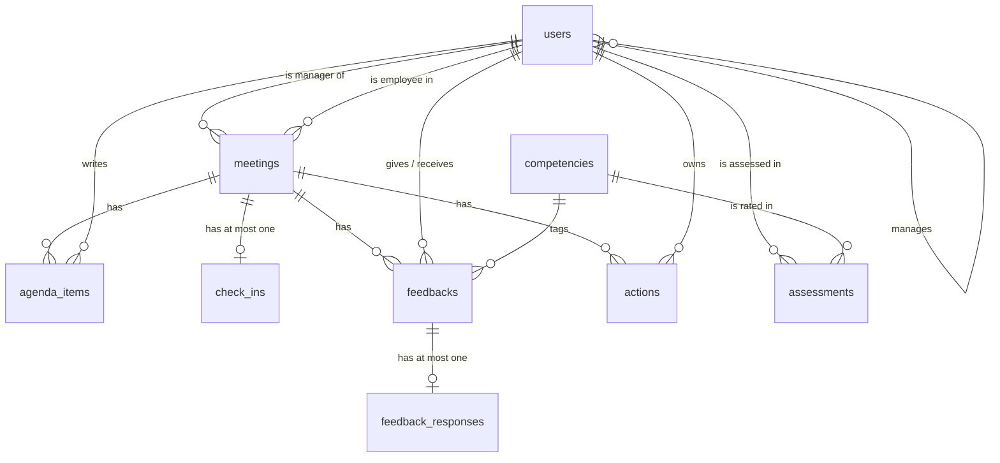

# Employee 1:1 Feedback & Development Tracker — Specification

## Purpose
A 1:1 meeting tracker for a manager and their direct reports. It replaces scattered notes with one shared history: what was discussed, what feedback was given, what was agreed, and how the employee is evolving over time. The employee can read each feedback and give feedback on it (feedback on the feedback), so the conversation goes both ways.

## Entities
This section is the database model. It has nine tables; every entity below is one table.

### Conventions
| Topic | Rule |
|---|---|
| DBMS | SQLite 3, accessed with the standard library `sqlite3`. Every connection runs `PRAGMA foreign_keys = ON`. |
| Names | Tables are plural `snake_case` (`feedback_responses`); columns are `snake_case`; a foreign key is `<entity>_id`. |
| Primary keys | `id INTEGER PRIMARY KEY` (SQLite assigns it automatically). |
| Dates | `TEXT` in `YYYY-MM-DD`. A `CHECK` makes sure the value is a real calendar date. |
| Timestamps | `TEXT` in ISO-8601 UTC, `YYYY-MM-DDTHH:MM:SSZ`. `created_at` is on every table; `updated_at` on tables whose rows change. The application sets `updated_at` on every UPDATE. |
| Booleans | `INTEGER` 0 or 1, with a `CHECK`. |
| Enumerations | `TEXT` with a `CHECK (... IN (...))`. The allowed values are in the *Enumerations* table below. |
| Optional values | Optional text is stored as `''` (never NULL). Optional dates, scores and foreign keys are NULL when absent. |
| Deleting data | The application never hard-deletes business data: users are deactivated (`is_active = 0`), meetings are cancelled, feedback is permanent. The `ON DELETE` rules below are only a safety net. |
| Text length | Maximum lengths are enforced twice: by the form validation (HTTP 400) and by a `CHECK` in the table. |

### Entity-relationship diagram


### Relationships
| Parent | Child | Cardinality | Foreign key | On delete |
|---|---|---|---|---|
| users | users | 1 manager : 0..n employees | `users.manager_id` | RESTRICT |
| users | meetings | 1 : 0..n (as manager) | `meetings.manager_id` | RESTRICT |
| users | meetings | 1 : 0..n (as employee) | `meetings.employee_id` | RESTRICT |
| meetings | agenda_items | 1 : 0..n | `agenda_items.meeting_id` | CASCADE |
| users | agenda_items | 1 : 0..n | `agenda_items.author_id` | RESTRICT |
| meetings | check_ins | 1 : 0..1 | `check_ins.meeting_id` (unique) | CASCADE |
| meetings | feedbacks | 1 : 0..n | `feedbacks.meeting_id` | RESTRICT |
| users | feedbacks | 1 : 0..n (as author) | `feedbacks.author_id` | RESTRICT |
| users | feedbacks | 1 : 0..n (as recipient) | `feedbacks.recipient_id` | RESTRICT |
| competencies | feedbacks | 1 : 0..n (optional) | `feedbacks.competency_id` | SET NULL |
| feedbacks | feedback_responses | 1 : 0..1 | `feedback_responses.feedback_id` (unique) | CASCADE |
| users | assessments | 1 : 0..n | `assessments.employee_id` | RESTRICT |
| competencies | assessments | 1 : 0..n | `assessments.competency_id` | RESTRICT |
| meetings | actions | 1 : 0..n | `actions.meeting_id` | CASCADE |
| users | actions | 1 : 0..n | `actions.owner_id` | RESTRICT |

### Table `users`
People who use the system. A manager has no `manager_id`; every employee has one.
| Column | Type | Null | Default | Constraints and meaning |
|---|---|---|---|---|
| id | INTEGER | no | auto | Primary key |
| name | TEXT | no | | 1–100 characters after trimming |
| email | TEXT | no | | Unique (case-insensitive), 3–254 characters |
| role | TEXT | no | | `manager` or `employee` |
| manager_id | INTEGER | yes | NULL | FK → `users.id`; required when `role = 'employee'`; cannot be the user's own id |
| is_active | INTEGER | no | 1 | 0 or 1; inactive users cannot sign in or be picked in forms |
| created_at | TEXT | no | now (UTC) | |
| updated_at | TEXT | no | now (UTC) | |

Index: `idx_users_manager (manager_id)`. A password hash column is added when real authentication is built (see Appendix E).

### Table `competencies`
The list of skills that employees are assessed on and that feedback can be tagged with.
| Column | Type | Null | Default | Constraints and meaning |
|---|---|---|---|---|
| id | INTEGER | no | auto | Primary key |
| name | TEXT | no | | Unique (case-insensitive), 1–60 characters, e.g. Communication |
| description | TEXT | no | `''` | Up to 300 characters |
| is_active | INTEGER | no | 1 | 0 or 1; inactive competencies stay in old assessments but are not offered in new forms |
| created_at | TEXT | no | now (UTC) | |

### Table `meetings`
One 1:1 between a manager and one of their employees.
| Column | Type | Null | Default | Constraints and meaning |
|---|---|---|---|---|
| id | INTEGER | no | auto | Primary key |
| manager_id | INTEGER | no | | FK → `users.id` (a manager) |
| employee_id | INTEGER | no | | FK → `users.id` (an employee); must differ from `manager_id` |
| meeting_date | TEXT | no | | Valid `YYYY-MM-DD` date |
| status | TEXT | no | `scheduled` | `scheduled`, `done` or `cancelled` |
| notes | TEXT | no | `''` | Shared notes, up to 5000 characters; the employee can read them |
| private_notes | TEXT | no | `''` | Manager-only notes, up to 5000 characters; never sent to the employee |
| created_at | TEXT | no | now (UTC) | |
| updated_at | TEXT | no | now (UTC) | |

Indexes: `idx_meetings_employee_date (employee_id, meeting_date)` for the employee's history; `idx_meetings_pair (manager_id, employee_id, status, meeting_date)` to find the next scheduled 1:1 of a pair.

### Table `agenda_items`
A topic to discuss in a meeting. Written by the manager, the employee, or generated automatically.
| Column | Type | Null | Default | Constraints and meaning |
|---|---|---|---|---|
| id | INTEGER | no | auto | Primary key |
| meeting_id | INTEGER | no | | FK → `meetings.id` |
| author_id | INTEGER | no | | FK → `users.id`; must be the meeting's manager or employee |
| text | TEXT | no | | 1–300 characters after trimming |
| origin | TEXT | no | `manual` | `manual`, `action` (carried over from an open action) or `feedback` (employee asked to talk about a feedback) |
| created_at | TEXT | no | now (UTC) | |

Index: `idx_agenda_meeting (meeting_id)`.

### Table `check_ins`
The employee's mood before a meeting. At most one per meeting.
| Column | Type | Null | Default | Constraints and meaning |
|---|---|---|---|---|
| id | INTEGER | no | auto | Primary key |
| meeting_id | INTEGER | no | | FK → `meetings.id`; **unique** |
| mood | INTEGER | no | | 1 (very low) to 5 (great) |
| comment | TEXT | no | `''` | Up to 300 characters |
| created_at | TEXT | no | now (UTC) | |
| updated_at | TEXT | no | now (UTC) | Saving again replaces the previous check-in |

### Table `feedbacks`
A piece of feedback the manager gives during a meeting. It is permanent: it is never edited or deleted once saved.
| Column | Type | Null | Default | Constraints and meaning |
|---|---|---|---|---|
| id | INTEGER | no | auto | Primary key |
| meeting_id | INTEGER | no | | FK → `meetings.id` |
| author_id | INTEGER | no | | FK → `users.id`; the meeting's manager |
| recipient_id | INTEGER | no | | FK → `users.id`; the meeting's employee; must differ from `author_id` |
| kind | TEXT | no | | `recognition`, `development` or `correction` |
| competency_id | INTEGER | yes | NULL | FK → `competencies.id` |
| text | TEXT | no | | 1–2000 characters after trimming |
| discussed | INTEGER | no | 0 | 0 or 1; becomes 1 once the employee's "I want to talk about this" has been put on an agenda |
| created_at | TEXT | no | now (UTC) | |

Indexes: `idx_feedbacks_meeting (meeting_id)`; `idx_feedbacks_recipient (recipient_id, created_at)`; `idx_feedbacks_author (author_id, discussed)`.

### Table `feedback_responses`
The employee's answer to one feedback (the "feedback on the feedback"). At most one per feedback.
| Column | Type | Null | Default | Constraints and meaning |
|---|---|---|---|---|
| id | INTEGER | no | auto | Primary key |
| feedback_id | INTEGER | no | | FK → `feedbacks.id`; **unique** |
| acknowledged_at | TEXT | yes | NULL | When the employee marked "read and understood" |
| clarity | INTEGER | yes | NULL | 1–5 |
| usefulness | INTEGER | yes | NULL | 1–5 |
| fairness | INTEGER | yes | NULL | 1–5 |
| tone | INTEGER | yes | NULL | 1–5 (how respectful the tone was) |
| comment | TEXT | no | `''` | Up to 1000 characters |
| wants_to_talk | INTEGER | no | 0 | 0 or 1 |
| manager_reply | TEXT | no | `''` | Up to 1000 characters; written by the feedback's author |
| created_at | TEXT | no | now (UTC) | |
| updated_at | TEXT | no | now (UTC) | |

Rules in the table: the four ratings are either all NULL or all between 1 and 5; ratings can only exist when `acknowledged_at` is filled.

### Table `assessments`
The score of one employee on one competency in one cycle, given by the manager and/or by the employee.
| Column | Type | Null | Default | Constraints and meaning |
|---|---|---|---|---|
| id | INTEGER | no | auto | Primary key |
| employee_id | INTEGER | no | | FK → `users.id` |
| competency_id | INTEGER | no | | FK → `competencies.id` |
| cycle | TEXT | no | | 1–20 characters, e.g. `2026-S2` (year and semester) |
| manager_score | INTEGER | yes | NULL | 1–5 |
| self_score | INTEGER | yes | NULL | 1–5 |
| justification | TEXT | no | `''` | Manager's reason for the score, up to 500 characters |
| created_at | TEXT | no | now (UTC) | |
| updated_at | TEXT | no | now (UTC) | |

Rules in the table: **unique** on (`employee_id`, `competency_id`, `cycle`); at least one of the two scores is filled. Index: `idx_assessments_employee_cycle (employee_id, cycle)`.

### Table `actions`
A task agreed in a meeting, owned by the manager or the employee.
| Column | Type | Null | Default | Constraints and meaning |
|---|---|---|---|---|
| id | INTEGER | no | auto | Primary key |
| meeting_id | INTEGER | no | | FK → `meetings.id` |
| owner_id | INTEGER | no | | FK → `users.id`; must be the meeting's manager or employee |
| description | TEXT | no | | 1–300 characters after trimming |
| due_date | TEXT | yes | NULL | Valid `YYYY-MM-DD` date |
| status | TEXT | no | `pending` | `pending`, `in_progress` or `done` |
| created_at | TEXT | no | now (UTC) | |
| updated_at | TEXT | no | now (UTC) | |

Indexes: `idx_actions_meeting (meeting_id)`; `idx_actions_owner_status (owner_id, status)` for "my open actions".

### Enumerations
| Column | Allowed values |
|---|---|
| users.role | manager, employee |
| meetings.status | scheduled, done, cancelled |
| agenda_items.origin | manual, action, feedback |
| feedbacks.kind | recognition, development, correction |
| actions.status | pending, in_progress, done |
| Scores (mood, clarity, usefulness, fairness, tone, manager_score, self_score) | integers 1 to 5 |

### Rules enforced by the application
SQL constraints cannot express these, so the Flask code checks them before every write.
- `meetings.manager_id` is the `manager_id` of the employee, and the signed-in manager can only create meetings for their own team.
- `feedbacks.author_id` and `recipient_id` are the manager and the employee of the meeting; only the recipient can create or change the response, and only the author can write `manager_reply`.
- `agenda_items.author_id` and `actions.owner_id` belong to the meeting's two participants.
- `meetings.private_notes` is read only by `meetings.manager_id` and is left out of everything sent to the employee.
- The feedback-quality average is calculated only when the manager has at least 3 rated responses.
- Creating a meeting copies open actions (`status <> 'done'`) and "wants to talk" feedbacks (`discussed = 0`) of the same pair into the new agenda.

### Data sensitivity
| Data | Class | Who may read it |
|---|---|---|
| `meetings.private_notes` | Restricted | The meeting's manager only |
| `feedbacks`, `feedback_responses` | Confidential | The author and the recipient |
| `check_ins`, `assessments`, `meetings.notes`, `agenda_items`, `actions` | Confidential | The employee and their manager |
| `users.name`, `users.email` | Personal | The employee, their manager and teammates of the manager |
| `competencies` | Internal | Everyone signed in |

### Key queries
```sql
-- Next scheduled 1:1 of a manager–employee pair
SELECT id FROM meetings
WHERE manager_id = ? AND employee_id = ? AND status = 'scheduled' AND meeting_date >= date('now')
ORDER BY meeting_date LIMIT 1;

-- Open actions to carry into the agenda of a new meeting
SELECT a.description FROM actions a JOIN meetings m ON m.id = a.meeting_id
WHERE m.manager_id = ? AND m.employee_id = ? AND a.status <> 'done' AND m.id <> ?;

-- How the team rates a manager's feedback (only with 3 or more rated responses)
SELECT COUNT(*) AS n, AVG(r.clarity) AS clarity, AVG(r.usefulness) AS usefulness,
       AVG(r.fairness) AS fairness, AVG(r.tone) AS tone
FROM feedback_responses r JOIN feedbacks f ON f.id = r.feedback_id
WHERE f.author_id = ? AND r.clarity IS NOT NULL
HAVING COUNT(*) >= 3;

-- Progress of one employee: scores per competency and cycle
SELECT c.name, a.cycle, a.manager_score, a.self_score
FROM assessments a JOIN competencies c ON c.id = a.competency_id
WHERE a.employee_id = ? ORDER BY a.cycle, c.id;
```

### Full DDL
```sql
PRAGMA foreign_keys = ON;

CREATE TABLE users (
  id          INTEGER PRIMARY KEY,
  name        TEXT    NOT NULL CHECK (length(trim(name)) BETWEEN 1 AND 100),
  email       TEXT    NOT NULL COLLATE NOCASE UNIQUE CHECK (length(email) BETWEEN 3 AND 254),
  role        TEXT    NOT NULL CHECK (role IN ('manager', 'employee')),
  manager_id  INTEGER REFERENCES users(id) ON DELETE RESTRICT,
  is_active   INTEGER NOT NULL DEFAULT 1 CHECK (is_active IN (0, 1)),
  created_at  TEXT    NOT NULL DEFAULT (strftime('%Y-%m-%dT%H:%M:%SZ', 'now')),
  updated_at  TEXT    NOT NULL DEFAULT (strftime('%Y-%m-%dT%H:%M:%SZ', 'now')),
  CHECK (manager_id IS NULL OR manager_id <> id),
  CHECK (role = 'manager' OR manager_id IS NOT NULL)
);
CREATE INDEX idx_users_manager ON users (manager_id);

CREATE TABLE competencies (
  id          INTEGER PRIMARY KEY,
  name        TEXT    NOT NULL COLLATE NOCASE UNIQUE CHECK (length(trim(name)) BETWEEN 1 AND 60),
  description TEXT    NOT NULL DEFAULT '' CHECK (length(description) <= 300),
  is_active   INTEGER NOT NULL DEFAULT 1 CHECK (is_active IN (0, 1)),
  created_at  TEXT    NOT NULL DEFAULT (strftime('%Y-%m-%dT%H:%M:%SZ', 'now'))
);

CREATE TABLE meetings (
  id            INTEGER PRIMARY KEY,
  manager_id    INTEGER NOT NULL REFERENCES users(id) ON DELETE RESTRICT,
  employee_id   INTEGER NOT NULL REFERENCES users(id) ON DELETE RESTRICT,
  meeting_date  TEXT    NOT NULL CHECK (date(meeting_date) IS meeting_date),
  status        TEXT    NOT NULL DEFAULT 'scheduled' CHECK (status IN ('scheduled', 'done', 'cancelled')),
  notes         TEXT    NOT NULL DEFAULT '' CHECK (length(notes) <= 5000),
  private_notes TEXT    NOT NULL DEFAULT '' CHECK (length(private_notes) <= 5000),
  created_at    TEXT    NOT NULL DEFAULT (strftime('%Y-%m-%dT%H:%M:%SZ', 'now')),
  updated_at    TEXT    NOT NULL DEFAULT (strftime('%Y-%m-%dT%H:%M:%SZ', 'now')),
  CHECK (manager_id <> employee_id)
);
CREATE INDEX idx_meetings_employee_date ON meetings (employee_id, meeting_date);
CREATE INDEX idx_meetings_pair ON meetings (manager_id, employee_id, status, meeting_date);

CREATE TABLE agenda_items (
  id          INTEGER PRIMARY KEY,
  meeting_id  INTEGER NOT NULL REFERENCES meetings(id) ON DELETE CASCADE,
  author_id   INTEGER NOT NULL REFERENCES users(id) ON DELETE RESTRICT,
  text        TEXT    NOT NULL CHECK (length(trim(text)) BETWEEN 1 AND 300),
  origin      TEXT    NOT NULL DEFAULT 'manual' CHECK (origin IN ('manual', 'action', 'feedback')),
  created_at  TEXT    NOT NULL DEFAULT (strftime('%Y-%m-%dT%H:%M:%SZ', 'now'))
);
CREATE INDEX idx_agenda_meeting ON agenda_items (meeting_id);

CREATE TABLE check_ins (
  id          INTEGER PRIMARY KEY,
  meeting_id  INTEGER NOT NULL UNIQUE REFERENCES meetings(id) ON DELETE CASCADE,
  mood        INTEGER NOT NULL CHECK (mood BETWEEN 1 AND 5),
  comment     TEXT    NOT NULL DEFAULT '' CHECK (length(comment) <= 300),
  created_at  TEXT    NOT NULL DEFAULT (strftime('%Y-%m-%dT%H:%M:%SZ', 'now')),
  updated_at  TEXT    NOT NULL DEFAULT (strftime('%Y-%m-%dT%H:%M:%SZ', 'now'))
);

CREATE TABLE feedbacks (
  id             INTEGER PRIMARY KEY,
  meeting_id     INTEGER NOT NULL REFERENCES meetings(id) ON DELETE RESTRICT,
  author_id      INTEGER NOT NULL REFERENCES users(id) ON DELETE RESTRICT,
  recipient_id   INTEGER NOT NULL REFERENCES users(id) ON DELETE RESTRICT,
  kind           TEXT    NOT NULL CHECK (kind IN ('recognition', 'development', 'correction')),
  competency_id  INTEGER REFERENCES competencies(id) ON DELETE SET NULL,
  text           TEXT    NOT NULL CHECK (length(trim(text)) BETWEEN 1 AND 2000),
  discussed      INTEGER NOT NULL DEFAULT 0 CHECK (discussed IN (0, 1)),
  created_at     TEXT    NOT NULL DEFAULT (strftime('%Y-%m-%dT%H:%M:%SZ', 'now')),
  CHECK (author_id <> recipient_id)
);
CREATE INDEX idx_feedbacks_meeting   ON feedbacks (meeting_id);
CREATE INDEX idx_feedbacks_recipient ON feedbacks (recipient_id, created_at);
CREATE INDEX idx_feedbacks_author    ON feedbacks (author_id, discussed);

CREATE TABLE feedback_responses (
  id              INTEGER PRIMARY KEY,
  feedback_id     INTEGER NOT NULL UNIQUE REFERENCES feedbacks(id) ON DELETE CASCADE,
  acknowledged_at TEXT,
  clarity         INTEGER,
  usefulness      INTEGER,
  fairness        INTEGER,
  tone            INTEGER,
  comment         TEXT    NOT NULL DEFAULT '' CHECK (length(comment) <= 1000),
  wants_to_talk   INTEGER NOT NULL DEFAULT 0 CHECK (wants_to_talk IN (0, 1)),
  manager_reply   TEXT    NOT NULL DEFAULT '' CHECK (length(manager_reply) <= 1000),
  created_at      TEXT    NOT NULL DEFAULT (strftime('%Y-%m-%dT%H:%M:%SZ', 'now')),
  updated_at      TEXT    NOT NULL DEFAULT (strftime('%Y-%m-%dT%H:%M:%SZ', 'now')),
  CHECK (
    (clarity IS NULL AND usefulness IS NULL AND fairness IS NULL AND tone IS NULL)
    OR
    (clarity     IS NOT NULL AND clarity     BETWEEN 1 AND 5 AND
     usefulness  IS NOT NULL AND usefulness  BETWEEN 1 AND 5 AND
     fairness    IS NOT NULL AND fairness    BETWEEN 1 AND 5 AND
     tone        IS NOT NULL AND tone        BETWEEN 1 AND 5 AND
     acknowledged_at IS NOT NULL)
  )
);

CREATE TABLE assessments (
  id             INTEGER PRIMARY KEY,
  employee_id    INTEGER NOT NULL REFERENCES users(id) ON DELETE RESTRICT,
  competency_id  INTEGER NOT NULL REFERENCES competencies(id) ON DELETE RESTRICT,
  cycle          TEXT    NOT NULL CHECK (length(trim(cycle)) BETWEEN 1 AND 20),
  manager_score  INTEGER CHECK (manager_score BETWEEN 1 AND 5),
  self_score     INTEGER CHECK (self_score BETWEEN 1 AND 5),
  justification  TEXT    NOT NULL DEFAULT '' CHECK (length(justification) <= 500),
  created_at     TEXT    NOT NULL DEFAULT (strftime('%Y-%m-%dT%H:%M:%SZ', 'now')),
  updated_at     TEXT    NOT NULL DEFAULT (strftime('%Y-%m-%dT%H:%M:%SZ', 'now')),
  UNIQUE (employee_id, competency_id, cycle),
  CHECK (manager_score IS NOT NULL OR self_score IS NOT NULL)
);
CREATE INDEX idx_assessments_employee_cycle ON assessments (employee_id, cycle);

CREATE TABLE actions (
  id           INTEGER PRIMARY KEY,
  meeting_id   INTEGER NOT NULL REFERENCES meetings(id) ON DELETE CASCADE,
  owner_id     INTEGER NOT NULL REFERENCES users(id) ON DELETE RESTRICT,
  description  TEXT    NOT NULL CHECK (length(trim(description)) BETWEEN 1 AND 300),
  due_date     TEXT    CHECK (due_date IS NULL OR date(due_date) IS due_date),
  status       TEXT    NOT NULL DEFAULT 'pending' CHECK (status IN ('pending', 'in_progress', 'done')),
  created_at   TEXT    NOT NULL DEFAULT (strftime('%Y-%m-%dT%H:%M:%SZ', 'now')),
  updated_at   TEXT    NOT NULL DEFAULT (strftime('%Y-%m-%dT%H:%M:%SZ', 'now'))
);
CREATE INDEX idx_actions_meeting      ON actions (meeting_id);
CREATE INDEX idx_actions_owner_status ON actions (owner_id, status);
```

## Routes
| Method | Path | Does |
|---|---|---|
| GET  | / | Redirect to /dashboard (or /login if nobody is signed in) |
| GET  | /login | Form to pick a test user |
| POST | /login | Sign in as that user, redirect to /dashboard |
| POST | /logout | Sign out, redirect to /login |
| GET  | /dashboard | Manager: team cards, "wants to talk" list, feedback-quality summary. Employee: next 1:1, feedback waiting for a response, open actions |
| GET  | /meetings/new | Form to schedule a 1:1 (manager only) |
| POST | /meetings/new | Create the 1:1, pre-fill its agenda, redirect to it |
| GET  | /meetings/<id> | Show one 1:1: agenda, check-in, notes, feedback, actions |
| POST | /meetings/<id>/agenda | Add an agenda item (manager or employee) |
| POST | /meetings/<id>/notes | Save shared notes, private notes and status (manager only) |
| POST | /meetings/<id>/checkin | Save the mood check-in (employee only) |
| POST | /meetings/<id>/feedback | Add feedback to the 1:1 (manager only) |
| POST | /meetings/<id>/actions | Add an action item |
| POST | /actions/<id>/status | Change an action's status, redirect back |
| GET  | /feedbacks/<id> | Show one feedback with its response |
| POST | /feedbacks/<id>/acknowledge | Employee marks "read and understood" |
| POST | /feedbacks/<id>/respond | Employee rates (clarity, usefulness, fairness, tone), comments, may tick "I want to talk about this" |
| POST | /feedbacks/<id>/reply | Manager replies to the employee's response |
| GET  | /employees/<id>/assess | Form to rate competencies for a cycle (manager rates the employee; the employee rates themselves) |
| POST | /employees/<id>/assess | Save the ratings, redirect to progress |
| GET  | /employees/<id>/progress | Competency chart per cycle, self vs. manager comparison, mood chart, actions done, timeline, feedback received |

## Behaviour rules
- **Validation is done on the server.** An empty required field, an out-of-range score, an unknown option or a malformed date re-renders the same page with an error message and **HTTP 400**. A successful POST redirects (POST → redirect → GET).
- **Who sees what.** An employee sees only their own meetings, feedback and progress. A manager sees only their own team. Anything else returns 404. Private notes are never sent to the employee's browser.
- **Feedback on the feedback.** Ratings are visible to the manager only as an average across the manager's feedback, and only once there are at least 3 rated responses, so a single employee cannot be identified. The ratings are not part of the employee's assessment.
- **"I want to talk about this."** Ticking it adds an agenda item to the next scheduled 1:1; if none exists, the item is added when the next 1:1 is created.
- **Carry-over.** When a 1:1 is created, every action from earlier 1:1s of the same pair that is not `done` is added to its agenda.
- **Assessments.** Saving the same cycle again updates the existing scores instead of creating duplicates.

## Technical constraints
- Python 3.11+, Flask 3.x
- SQLite via the standard library `sqlite3` (no ORM)
- Jinja2 templates in `templates/`, all extending one base template (`base.html`)
- Charts are server-side inline SVG; no JavaScript at all
- No real authentication: the login page lets you pick one of the seeded test users (session cookie, no passwords)
- CSRF token on every POST form
- No packages beyond Flask

## Out of scope
Real user accounts and passwords · HR/admin role · goals/OKRs · recurring meetings · reminders and e-mail · file attachments · PDF export · an API · search · peer feedback

---

## Appendix A — Improvements over the original idea
The original idea was: record the employee's evolution, let the employee read the feedback and give feedback on it. These additions were made on top of it. Items marked ✔ are in the proof of concept.

| # | Improvement | Why |
|---|---|---|
| ✔ 1 | Mood check-in before each 1:1 | Gives the manager context before the conversation and a history of well-being. |
| ✔ 2 | Action plan with carry-over | Stops agreements from being forgotten: what is still open returns to the next agenda. |
| ✔ 3 | Self-assessment vs. manager assessment | The gap between the two scores is the best starting point for a development conversation. |
| ✔ 4 | Private manager notes | Managers write candidly only if they have a space the employee cannot see. |
| ✔ 5 | "I want to talk about this" on feedback | Turns disagreement into an agenda item instead of silent resentment. |
| ✔ 6 | Feedback rated on four criteria | Clarity, usefulness, fairness and tone tell the manager *how* the feedback landed. |
| 7 | Agenda templates (first 1:1, career, performance) | Less preparation effort. |
| 8 | Guided feedback format (Situation–Behaviour–Impact) | Better written feedback. |
| 9 | Reminders and notifications (e-mail / Slack) | Higher adoption of the ritual. |
| 10 | Peer feedback and public recognition | Path towards 360° feedback. |
| 11 | Individual development plan with courses and mentoring | Connects the conversation to career growth. |
| 12 | PDF export of the history | Useful for promotion cycles. |
| 13 | AI summary of notes | Helps spot patterns; needs consent and privacy care. |

## Appendix B — Main flows
**A — Life of a 1:1.** The manager schedules it → the employee does the mood check-in and adds agenda items → the meeting happens; the manager records notes, feedback and actions → the employee receives the feedback.

**B — Feedback on the feedback.** The employee opens the feedback → marks "read and understood" → rates it (clarity, usefulness, fairness, tone) → comments → optionally ticks "I want to talk about this", which puts it on the next agenda → the manager sees the response and replies.

**C — Progress.** At the end of each cycle the employee self-assesses and the manager assesses → the app plots progress per competency and shows the gap between the two views → large gaps (2 points or more) are good topics for the next 1:1.

## Appendix C — Acceptance criteria
- An employee can never open another employee's data (meetings, feedback, progress) — the server answers 404.
- Private notes never appear in any page the employee receives.
- Ticking "I want to talk about this" makes an item appear on the agenda of the next 1:1 of the same manager–employee pair.
- Open actions from a previous 1:1 appear on the agenda of the next one; completed actions do not.
- Empty fields, scores outside 1–5, invalid dates and unknown options are rejected on the server with HTTP 400 and an error message.
- A POST without a valid CSRF token is rejected.
- User-entered text is HTML-escaped (no script injection).

These are checked by `smoke_test.py` (40 checks).

## Appendix D — Non-functional requirements and risks
| Area | Requirement for the full product |
|---|---|
| Security | Password hashing, role- and team-based access control, CSRF protection, output escaping. |
| Privacy (LGPD) | Documented purpose and legal basis; employees can request a copy of their data; defined retention period; access log for sensitive records. |
| Performance | Main pages under 2 s for up to 500 users. |
| Usability | Responsive (desktop and phone); accessible (contrast, keyboard navigation). |
| Audit | Record who created or edited feedback and assessments; published feedback is never deleted, corrections create a new version. |
| Language | Portuguese (Brazil) first, structure ready for translation. |

Risks to handle: employees may feel monitored, so it must be clear who sees what (private notes are never visible to the employee or HR); rating the feedback must never feed into the employee's own performance review; averages are hidden when there are fewer than 3 responses.

## Appendix E — Roadmap
| Phase | Delivery |
|---|---|
| **POC** (this version) | Everything in the sections above the appendices. |
| **MVP** | Real authentication, recurring 1:1s, goals, e-mail notifications, basic HR reports. |
| **v1** | Agenda templates, development plans, PDF export, feedback-quality dashboard per team. |
| **v2** | Peer feedback, Slack/Teams/calendar integrations, AI summary with consent. |
